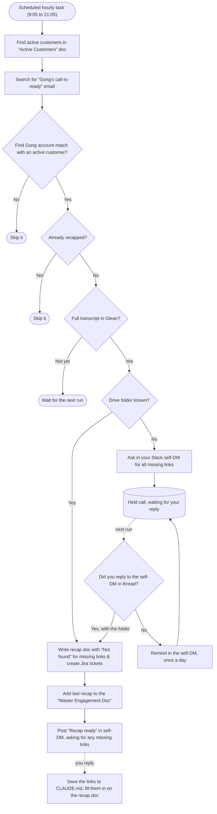

# ai-sa-skills

Claude Code skills that take the busywork out of running customer engagements: prepare for a meeting, automatically recap meetings (no prompt needed) and create a customer-facing document of all meetings, create Jira tickets as needed, and create a historical deep research for old-logo customers.

This repo includes:

- **An installer** (`install.sh`) and a **setup guide** ([ACCESS-AND-SETUP.md](ACCESS-AND-SETUP.md)).
  The installer asks a few questions, installs the skills with your settings, and creates your
  **Active Customers Doc**, the Google Doc listing the customers the skills use and easy to maintain. 
  The guide walks you through the Jira and Google Drive sign-ins.
- **An automated workflow** (`customer-recap-check`): an hourly scheduled task in the Claude
  desktop app. It finds Gong's "call is ready" emails for your Active customers, writes the
  recap and Jira tickets, updates the customer-facing Doc, and reports in your Slack self-DM.
  See "`customer-recap-check` workflow" below for the flowchart.
- **Five Claude Code skills** (in `claude-code/`):

| Skill | What it does | How it runs |
|---|---|---|
| **`customer-meeting-recap`** | After a call, turns the recording or transcript into a recap Google Doc in the customer's Drive folder, and creates a Jira ticket for every follow-up the LaunchDarkly team committed to | **Manual:** you prompt it (`/customer-meeting-recap`). The recap check also runs it automatically |
| **`customer-session-prep`** | Before a call, writes a one-page prep brief (a Google Doc in the same folder) from that folder's recaps, so you know in two minutes what to deliver, what's still open, and what to ask | **Manual:** you prompt it (`/customer-session-prep`) |
| **`customer-engagement-prep`** | The same brief plus the engagement's history (earlier engagements, older folders, every Gong call), for a new engagement or an account you're picking up | **Manual:** you prompt it (`/customer-engagement-prep`) |
| **`customer-shared-notes`** | Adds each recap to the customer-facing `<Customer>-LaunchDarkly Master Engagement Doc`, newest meeting on top, without Jira tickets or internal links | **Manual** (`/customer-shared-notes`), and **automatic:** the recap check runs it after every recap |
| **`customer-recap-check`** | Every hour, looks for Gong's "call is ready" emails for your Active customers, recaps the new ones, updates the Master Engagement Doc, and tells you in your Slack self-DM, asking there when links are missing | **Automatic workflow:** a scheduled task in the Claude desktop app, set up once ("set up the recap check") |

**Where you call them from:** Claude Code. You can't call them from Slack or the Chat tab. Slack is only
where the recap check reports to you and asks for missing links; you answer by replying in the
post's thread, and the next hourly run reads your reply.

## The problem these solve

After every customer call, the same manual work: rewatch the recording, write up what was
discussed and decided, list who promised what, open a ticket for each of your tasks, and file
it all in the right customer folder. Before the next call, you dig through old notes, tickets,
support cases and docs to remember where things stand.

Doing this with Claude sounds easy, but the Claude desktop app's **Chat tab** can't do it on its
own. It runs in the cloud, so it can't use tools on your computer, and it has no way to *write*
to Jira or Google Drive. A search connector like Glean can read Jira, Drive, Gong and Salesforce
but can't create tickets or documents. API keys in a local `.env` don't help either, because the
Chat tab can't see your files.

These skills run in **Claude Code** instead (the desktop app's **Code tab**, or a terminal), on
your own computer, where they can use:

| For | They use | Why |
|---|---|---|
| Reading call transcripts, Salesforce, Drive, Jira and Slack | **Glean** (Claude connector) | Already searches everything you have access to |
| Knowing a call is ready to recap (recap check) | Gong's **"call is ready" email**, read from your Gmail through **Glean** | Arrives about two hours before Glean's Gong search finds the call, and only goes to people who were on it |
| Creating Jira epics and tickets | **Atlassian CLI (`acli`)** with your Jira **API token** | Writes to Jira without an OAuth app, which company admins often block |
| Saving and reading Google Docs | A small **Drive helper** (`gdrive.py`) with your own Google **OAuth client** | Writes real Google Docs into the customer's folder, and can only touch the Docs it created |
| Telling you a recap is ready, and asking you for missing links (recap check and recap) | **Slack** (Claude connector): posts to your self-DM by sharing a small file, reads your replies | The connector's file-sharing tools are the ones that can post; it never posts anywhere but your self-DM |
| Running on a schedule (recap check) | A Claude Code **scheduled task** in the desktop app | Runs on your Mac with your sign-ins; nothing runs in the cloud |

## What each skill produces

### `customer-meeting-recap`

You say something like *"Recap this call: \<Gong link\>"*, or paste a transcript.

1. **Reads the whole call.** From your paste, or the full Gong transcript through Glean, never
   Gong's summary. It works out who each speaker is.
2. **Asks once for any missing link** (Drive folder, Salesforce, Vitalstatistix, session plan,
   the customer's Slack channels) in one message, in chat and in your Slack self-DM, and waits
   for your answer before it saves anything. Answer in either place. If you don't answer, the
   hourly recap check picks the call up from the Slack thread, as for its own calls. Links you
   skip become `Not found`, and it lists them at the end.
3. **Reads what came before.** The previous recap in the customer's Drive folder, so it can mark
   earlier action items as done or still open, and the customer's Slack channels since the last
   call, for follow-ups and promises. Channels are never named in the recap or tickets.
4. **Writes the recap** and saves it as `<Customer> – Meeting Recap – <date>` in the Drive folder:
   - Summary and what was discussed, including decisions
   - Artifacts shared, plus relevant LaunchDarkly docs (only links it has confirmed exist)
   - Scheduled meetings, with dates
   - **Action items – LaunchDarkly team**, with owner, due date and Jira ticket
   - **Action items – \<Customer\>**, with owner and due date
   - **Next steps**: open questions (theirs and ours) and decisions still to make, never
     repeating an action item
   - The status of the previous recap's action items
   - **Customer links**: opportunity, Salesforce, Drive folder, Vitalstatistix, Jira epic, team
5. **Finds or creates the customer's Jira epic** (named after the customer, in Title Case) in your
   own Jira project.
6. **Creates one ticket per LaunchDarkly team action item**, skipping any that already exist:
   - **Title:** `<Owner>: <short task>`, e.g. `Alex: Confirm Big Segments Need Persistent Store`.
     No customer name, since the epic already says that.
   - **Assignee:** you, if it's your task. Other people's tasks are left unassigned, so the name in
     the title tells you it's one you only need to follow up on.
   - **Description:** the ask, background, why it matters, a one-sentence definition of done,
     and the customer links.

### `customer-session-prep`

The quick prep. You say something like *"Prep me for the next Acme session"*. It looks only at the
customer's current Drive folder (the one you give, or the Folder link in your Active Customers
Doc): the recaps in it, the follow-up items from them that are still open (checking their Jira
tickets), the customer's support tickets, tech stack, session plan and links, and the Slack
channels in your Active Customers Doc. It saves a one-page brief as
`<Customer> – Session Prep – <session name> (<date or date TBD>)`:

- Goal for the session and the latest status
- **Deliver in \<session name\> (\<date or date TBD\>):** finished tickets to show or explain, and
  open ones that are due
- The customer's next steps and questions, each with a draft answer or a docs link
- Action items to follow up on, split into the customer's items and LD's internal items
- Support tickets, tech stack, and where the engagement stands in the session plan
- All the links in one place, each labelled with the customer's name

It doesn't look at earlier engagements, older folders or the customer's other Gong calls. That's
`customer-engagement-prep`.

### `customer-engagement-prep`

The full prep, with the engagement's history: use it for a new engagement, or an existing customer
(an existing logo) you're picking up. On top of what `customer-session-prep` reads, it searches the
team's older Drive folders and every Gong call for the account, and saves
`<Customer> – Engagement Prep and Next Session (<session name>, <date or date TBD>)`, for example
`Acme Corp – Engagement Prep and Next Session (kickoff, date TBD)`:

- Everything in the session prep brief
- **Where the earlier engagement left off:** each planned session from the old kickoff deck,
  checked against the Gong calls as happened, partly happened or never happened, plus promises
  still open and worksheets never filled in

Both briefs use the customer's name and "LD" instead of "they" or "we", so they read clearly
when you forward them.

### `customer-recap-check`

You set it up once ("set up the recap check"). After that, a scheduled task runs it every hour,
by default from 9:05 to 21:05 on weekdays, and you don't prompt anything. The schedule is the only
trigger: a call whose Gong email arrives by about 21:00 is recapped the same day, and a later one
at the first check of the next weekday.

1. **Reads your Active Customers Doc** (see "Your Active Customers Doc" below) and works only on
   the rows marked Active.
2. **Finds Gong's "call is ready" emails for your active customers only,** since the last run
   (Gmail, through Glean). It searches once per Active row, by its Gong account, and works only on
   emails whose Gong account exactly matches an Active row. Anything else is skipped silently, so
   other calls make no work. Gong sends one to each
   participant when a call's recording is ready, so it knows you were on the call. It reads only
   the call link, account, date and duration from each email.
3. **Skips calls already recapped,** using a processed-calls log on your Mac and the Gong call ID
   each recap records, so a call is never recapped twice.
4. **Waits for the full transcript** in Glean, and writes the recap only from it.
5. **Runs `customer-meeting-recap` unattended:** it never stops to wait. Only a missing Drive
   folder holds the call, since there's nowhere to save the recap: it asks you in Slack, and
   reminds you at most once a day. Anything else missing (which opportunity it is, Salesforce,
   Vitalstatistix, session plan, Slack channels) doesn't hold it: the recap and tickets are made
   with `Not found` for it, and the "recap ready" post asks you for it. When you reply, the link
   is saved to the customer's `CLAUDE.md` and filled in on the recap Doc. If the opportunity was
   missing, the meeting is then added to the Master Engagement Doc (which never shows internal
   links).
6. **Updates the Master Engagement Doc:** after each finished recap, runs `customer-shared-notes`
   to add the meeting to the opportunity's customer-facing `<Customer> & LaunchDarkly – Meeting
   Notes` Doc. It runs only once the recap is saved, never in dry-run mode, and never adds a
   meeting twice.
7. **Posts to your Slack self-DM:** "recap ready" with the links, including the Master Engagement Doc, or
   a question you answer by replying in the post's thread. The next run reads your reply and
   finishes the call. A Claude notification on your Mac and phone pings you too, since Slack
   doesn't notify you about posts made as you.
8. **Logs everything** to one Markdown file on your Mac, `~/.config/sa-skills/recap-check-log.md`:
   a section per run, with an **activity** line for every step and tool call and an **audit**
   line for every change made in Drive, Jira or Slack. Nothing is logged to Drive.

It starts in **dry-run mode** (see below): it only reports what it would do, until you switch it
to live.

#### `customer-recap-check` workflow

What each hourly run does, in live mode:



**Log:** every step is logged as it happens, with its own time, to
`~/.config/sa-skills/recap-check-log.md` on your Mac (one section per run). The run ends with a
one-line summary. Nothing is logged to Drive.

**Replying:** reply in the thread of the post that asked, in your Slack self-DM, with the links.
Replying "skip" for a link writes `Not found` for it, and it isn't asked for again.

**Not in the diagram:** you can still run `/customer-meeting-recap` yourself at any time, for
example for a call the check skipped. It asks you for missing links in chat and in your self-DM,
and if you don't answer, the next hourly run finishes the call from the Slack thread.

#### Dry-run mode

Dry-run mode is a trial mode, so you can see what the check would do before it writes anything.
**The check starts in dry-run mode when you set it up,** and stays in it until you say "switch
the recap check to live".

- **What it does:** every hourly run reads your Active Customers Doc, finds and matches the Gong
  emails, and skips calls already done, exactly as in live mode. Then, instead of the recap, it
  posts one message per call in your self-DM: "Dry run: would recap *\<title\>* with
  \<Customer\> and add it to the Master Engagement Doc; links missing: \<links\>".
- **What it doesn't do:** it writes no recap, creates no Jira tickets, doesn't touch the Master
  Engagement Doc, and asks no questions. Its log lines are marked "dry run".
- **What it's for:** checking that your Active Customers rows (Gong account, Folder link) find the
  right calls, and that the links each recap needs are in place, before anything is created.
- **Going live:** say "switch the recap check to live" (or "switch the recap check to dry run" to
  go back). Calls a dry run reported in the last 2 days are then recapped for real. Older ones
  are skipped.

## Your Active Customers Doc

One Google Doc in your own Drive folder, `Active Customers`, that you keep yourself and can edit
from any device. **Every customer skill reads it first and works only on customers marked
Active** (any case), so old customers are left alone. Put in it whatever you want the skills to
know:

| Customer | Documentation name | Folder link | Slack channels | Gong account | Status |
| --- | --- | --- | --- | --- | --- |
| Acme | Acme Corp | `<Drive folder link>` | `<Slack channel links>` | Acme Corporation | Active |

- **Customer:** your name for it. Its local folder is that name in lowercase, with hyphens.
- **Documentation name:** the name used in every Doc, e.g. `Acme Corp – Meeting Recap –
  2026-10-26`. Blank: the Customer value is used.
- **Folder link:** the Drive folder where the customer's recaps and prep briefs live.
- **Slack channels:** the customer's channels and chats (shared channel, internal account channel,
  group DMs). The skills read them for context and never name them in a Doc or ticket.
- **Gong account:** the account name Gong shows, so the recap check finds the customer's calls.
- **Status:** Active or Not active.

Its links are copied into each customer's `CLAUDE.md` for the skills' reference. If the two
disagree, the Doc wins. A customer that isn't in the Doc, or isn't Active, gets a message
asking you to mark it Active, and nothing else. `install.sh` creates the Doc (its last question), and
"set up the recap check" creates it if it's still missing. Without it, the skills work from
`CLAUDE.md` alone.

## How it keeps track of each customer

Each customer gets a small local folder, e.g. `~/work/customers/acme/`, holding a single
`CLAUDE.md`. Claude Code reads it automatically when you open a session there. It's an address
book, not notes: the customer's Jira epic, team, latest call and tech stack, and a list of
**opportunities**, each with its own links:

```
## Opportunities
### RSA50 opportunity (1)    ← Salesforce opportunity, Drive folder, Vitalstatistix, session plan
### RSA100 opportunity
### RSA50 opportunity (2)
```

- **The skills create and update this file for you** as they learn links, people and facts.
- **They never guess links.** Salesforce, Drive and Vitalstatistix links come only from your
  prompt, the opportunity's own Drive folder, or your answer. If one is missing, the skill asks
  you for all the missing ones in one message.
- **Slack channels come only from you.** The recap asks for the customer's channels and chats
  (shared channel, internal account channel, group DMs) and saves them in a **Slack** section.
  It never searches for them, and never names them in a Doc or ticket.
- **New opportunity?** Give the skill the new Salesforce link (or say it's a new opportunity). It
  adds a new entry and asks, link by link, whether to reuse an existing opportunity's link or use
  a new one.

Everything the skills *produce* (recaps, briefs, transcripts) goes to Google Drive. Nothing but
this `CLAUDE.md` is kept on your computer.

## Install

### Prerequisites

- **Claude Code**, with the **Glean** and **Slack** connectors switched on. In the Claude
  desktop app, open the connectors settings and check both are connected and on. Glean reads
  Gong emails and transcripts, Drive, Jira and Salesforce; Slack reads the customer's channels
  and posts to your self-DM.
- **Your Gmail comes through Glean,** so no extra API, token or Gmail connector is needed. Your
  company connects Gmail to Glean, and Glean only returns what you can see yourself; the recap
  check uses it to find Gong's "call is ready" emails, and opens no other mail. Check that a
  Glean search shows your Gmail. (The Google token you create below covers only the Drive files
  the skills make, and the Jira token only Jira: neither can read your Gmail.)
- **macOS** with Homebrew and Python 3 (tested on macOS; Linux should work with small changes).
- **A Jira project of your own** for customer tasks, plus a **Jira API token**.
- **Edit access to each customer's Google Drive folder**, plus a **Google OAuth client** you
  create in your company's Google Cloud organization.

#### About the credentials

You create **two credentials, once**. Neither is an API key you paste anywhere: both stay in
private files on your computer, and Claude never reads them.

| | Jira | Google Drive |
|---|---|---|
| What it is | An **API token** from your Atlassian account | An **OAuth client** (Client ID + secret) from your own Google Cloud project |
| How it's used | `acli` signs in with it once, using your email | You sign in once in the browser; that creates a token the helper reuses |
| Where it's kept | `~/.config/acli/token.txt` | `~/.config/sa-skills/google/` |
| What it can reach | What your Jira account can | **Only the Docs the helper created** (Google's `drive.file` permission) |
| Expires | On the date you choose (up to about a year) | Renews itself |

Why not simpler options? At many companies the Atlassian MCP connector and `acli`'s browser
sign-in are blocked by admin policy, and Claude has no Google Drive connector with write access.
The API token and your own OAuth client are what work. [ACCESS-AND-SETUP.md](ACCESS-AND-SETUP.md)
has the full details, including what we found blocked.

### Run the installer

**1. Get the repo.**

```bash
git clone <this repo's URL>
```

**2. Set your Jira project key, once, before the first install.** It's the project your customer
tasks go to: the letters before the dash in ticket keys (`ABC` in `ABC-123`). It's the project's
short name, not a secret or an API key, and it's separate from your API token. Use your own project, so your tickets
don't land in someone else's. The installer doesn't ask for it; it stops and reminds you if it
isn't set.

To find your key, open any ticket in the project where your customer tasks should go. The
ticket number starts with the key: for a ticket `SA-482`, the key is `SA`. Replace `ABC` with
your key:

```bash
cd ai-sa-skills && python3 claude-code/customer-recap-check/scripts/recap_check.py config set jira_project ABC
```

To change it later, run the same command with the new key, then the installer again.

**3. Run the installer** from the same folder:

```bash
./install.sh
```

It asks these questions. Each one suggests a value: press **Enter** (or type `y`) to keep it.

| # | It asks | What to answer | Why it's asked |
|---|---|---|---|
| 1 | Where should the skills be installed? | **Enter** for `~/.claude/skills` (recommended: available in every Claude Code session), or `2` for one project's `.claude/skills` | Claude Code loads skills from these folders |
| 2 | What is the local path you want your customer CLAUDE.md files saved in? | **Enter** to keep it, or type another folder path starting with `~/` or `/`, e.g. `~/clients` | Where each customer's `CLAUDE.md` of links goes. Recaps and briefs are saved to Google Drive, not here |
| 3 | Confirm your Jira site is `launchdarkly.atlassian.net` | **Enter** to confirm, or type another site | For ticket links |
| 4 | Optional: your team's base Google Drive folder for customer projects | Paste the folder link, or type `pass` to skip | The prep skill searches it for earlier engagements with an existing customer. If you skip it, the skill asks for folders when it needs them |
| 5 | Your own Google Drive folder, where I'll create your Active Customers Doc | Paste the folder link, **Enter** to keep a saved one, or type `pass` to skip for now | Every customer skill reads the Doc. If you skip it, setting up the recap check asks for the folder |

Then it shows **"Please confirm your selections"**, with every answer and your Jira project key.
Check them, then press **Enter** to install, or type `n` to stop without changing anything.
An answer that doesn't fit (a "yes" where a folder or site should be) is asked again, never saved.

**What it replaces, and what it leaves alone,** when things already exist (it's safe to rerun):

| Already there | What the installer does |
|---|---|
| The installed skills it installs (`customer-meeting-recap`, `customer-session-prep`, `customer-engagement-prep`, `customer-recap-check`) in the skills folder | **Replaced** with this repo's copy. Any edits you made to the installed copy are lost: edit `claude-code/` instead |
| Other skills in the same skills folder | Left alone |
| Your customer folders and each customer's `CLAUDE.md` | Left alone. It only creates the top folder if it's missing |
| `~/.config/sa-skills/config.json` | Your answers are updated; everything else in it (Jira project key, Slack self-DM, recap check mode) is kept |
| The processed-calls log, run log and shared-notes ledger in `~/.config/sa-skills/` | Left alone |
| Your Active Customers Doc | Left alone: it finds the Doc already in the folder instead of making a second one |
| Google and Jira sign-ins | Never read or changed |
| The Drive helper's Python libraries | Reused; only missing ones are installed |

It also installs the Drive helper's Python libraries, then shows which sign-ins are still needed
and the link to your Active Customers Doc. The Doc needs the Google Drive sign-in, so on a first
install it's created when you run `./install.sh` again after signing in.
Your answers are saved in `~/.config/sa-skills/config.json` and offered as defaults next time.
Rerunning it keeps the settings the skills saved there themselves, such as your Slack self-DM.
It never asks for, reads or prints a token or secret.

**Then sign in, once (about 25 minutes):** follow Parts A and B of
[ACCESS-AND-SETUP.md](ACCESS-AND-SETUP.md):

- **Part A, Jira:** install `acli`, create an API token, save it to a private file, sign in
  (short version below).
- **Part B, Google Drive:** create a Google Cloud project and OAuth client, save it with the
  helper's `setup-client` command (the secret stays hidden as you paste), sign in in the browser.

#### Jira sign-in, short version

**1. Install `acli`** (the Atlassian CLI), one command at a time in your terminal:

```bash
brew tap atlassian/homebrew-acli
```

```bash
brew trust atlassian/acli
```

```bash
brew install acli
```

**2. Create an API token** in your Atlassian account's **Security** settings:
https://id.atlassian.com/manage-profile/security → **Create and manage API tokens** →
**Create API token**. Pick the plain one, not "with scopes": it gets exactly your own Jira
permissions, and the skills need nothing more than you already have (view and create issues
in your own project and comment on them). Name it e.g. `acli-claude-code`, pick an expiry date,
then **Copy**. It's shown only once.

**3. Save it to a private file,** `~/.config/acli/token.txt`, right after clicking Copy:

```bash
mkdir -p ~/.config/acli && pbpaste > ~/.config/acli/token.txt && chmod 600 ~/.config/acli/token.txt
```

The file holds only the token, on one line, no quotes or label. It looks like this (made up,
and much shorter than a real one, which is about 190 characters):

```text
ATATT3xFfGF0Ex4mPleT0kenN0tReal1234567890abcdef=A1B2C3D4
```

Check its size without printing it: `wc -c < ~/.config/acli/token.txt` should say about 190.
Never paste the token into a chat or a repo file.

**4. Sign `acli` in to Jira.** This uses the token file from step 3, so you never type the token.
Replace the site and email with yours:

```bash
acli jira auth login --site yourcompany.atlassian.net --email you@yourcompany.com --token < ~/.config/acli/token.txt
```

You should see `✓ Authentication successful`. `acli` remembers the sign-in, so the skills can create
and read your tickets from then on; `acli jira auth status` checks it. The full steps, and what to do if one fails, are in
[ACCESS-AND-SETUP.md](ACCESS-AND-SETUP.md), Part A.

#### Google Drive sign-in, short version

The skills save Docs to your Drive with their own small app, which you create once in Google
Cloud. Do these in order, each in your browser with your work Google account:

**1. Create a project:** https://console.cloud.google.com/projectcreate. Name it e.g.
`ai-sa-skills-<yourname>`, set **Organization** to your company's (not "No organization"), then
select it in the project picker at the top.

**2. Turn on the Drive API:** https://console.cloud.google.com/apis/library/drive.googleapis.com →
**Enable**.

**3. Set up the consent screen:** https://console.cloud.google.com/auth/overview → **Get started**.
App name `SA skills`, your email as contact, **Audience: Internal** (no Google review needed).

**4. Create the OAuth client:** https://console.cloud.google.com/auth/clients → **Create client** →
**Desktop app** → **Create**. Keep the dialog open: it shows the **Client ID** (ends in
`.apps.googleusercontent.com`) and the **Client secret** (starts with `GOCSPX-`).

**5. Save the client** in your terminal. It asks for the ID, then the secret, which stays hidden
as you paste:

```bash
~/.local/share/sa-skills/venv/bin/python -W ignore ~/.claude/skills/customer-meeting-recap/scripts/gdrive.py setup-client
```

It saves them to `~/.config/sa-skills/google/client_secret.json`, readable only by you, and
prints `{"saved": ".../client_secret.json"}`. The file is Google's standard format. With made-up
values it looks like this; never paste yours into a chat or a repo file:

```json
{"installed": {"client_id": "123456789012-abc123def456.apps.googleusercontent.com",
               "client_secret": "GOCSPX-MadeUpExampleNotReal123456",
               "auth_uri": "https://accounts.google.com/o/oauth2/auth",
               "token_uri": "https://oauth2.googleapis.com/token",
               "redirect_uris": ["http://localhost"]}}
```

**6. Sign in:**

```bash
~/.local/share/sa-skills/venv/bin/python -W ignore ~/.claude/skills/customer-meeting-recap/scripts/gdrive.py login
```

A browser opens: pick your work account and click **Allow**. The only permission it asks for is
"See, edit, create and delete only the specific Google Drive files you use with this app": it can't
see the rest of your Drive. The terminal prints `{"signed_in_as": "you@yourcompany.com"}`, and the
sign-in is saved in `~/.config/sa-skills/google/token.json`. Full steps and fixes:
[ACCESS-AND-SETUP.md](ACCESS-AND-SETUP.md), Part B.

Run `./install.sh` again afterwards: it fills in your Jira site for you, shows that both
sign-ins are done, and creates your Active Customers Doc. Open it from the link it prints and add
a row per customer, marked Active.

## How to use it best

### 1. Work in Claude Code, one project per customer

Use **Claude Code**: the Claude desktop app's **Code tab**, or `claude` in a terminal. Not the
Chat tab, where the skills can't reach Jira or Drive.

Give each customer **its own project**: a folder named after the customer inside your customers
folder, e.g. `~/work/customers/acme`. Always start that customer's sessions there:

- **Desktop app:** in the Code tab, start a new session and choose the customer's folder.
- **Terminal:** `cd ~/work/customers/acme && claude`.

Working from the customer's folder is what makes it effortless: Claude Code loads that folder's
`CLAUDE.md` automatically, so every session already knows the customer, its opportunities, Drive
folders, Jira epic and team, and you don't repeat links.

For a **new customer**, create the folder (`mkdir ~/work/customers/acme`) and open a session there,
or run the first skill from your customers folder and it creates the customer's folder for you.
Then switch to that folder for later sessions.

### 2. Call the skills by name

Type the skill as a slash command, followed by whatever you have for this call:

| Command | When |
|---|---|
| `/customer-meeting-recap` | After a call: recap Doc + Jira tickets |
| `/customer-session-prep` | Before a call: one-page prep brief from the current folder's recaps |
| `/customer-engagement-prep` | Before a call, with the engagement's history: new engagements and accounts you're picking up |

You can also just ask ("recap this call", "prep me for Thursday's session") and Claude picks the
right skill. The slash command makes sure.

### 3. Add links as needed

The skill only knows what's in your prompt, the customer's `CLAUDE.md` and the opportunity's
Drive folder. Give it links the first time, and whenever something new comes up. It saves them
to `CLAUDE.md`, so later runs need only the call.

**First recap for a new customer:** give it everything you have.

```
/customer-meeting-recap <Gong link>
Drive folder: <Drive folder link>
Salesforce opportunity: <Salesforce link>
Vitalstatistix: <Vitalstatistix link>
```

**Every recap after that:** just the call. Paste the transcript instead if there's no recording.

```
/customer-meeting-recap <Gong link>
```

**A new opportunity for an existing customer:** add its Salesforce link. The skill adds a new
opportunity to `CLAUDE.md` and asks, link by link, whether to reuse the existing Drive folder and
Vitalstatistix links or use new ones.

```
/customer-meeting-recap <Gong link>
New opportunity: <new Salesforce link>
```

**Before a call:** name the session or date if it isn't the next one, and the opportunity if the
customer has several.

```
/customer-session-prep
/customer-session-prep for the 2026-11-04 session, RSA100 opportunity
```

**Picking up an existing customer:** use `/customer-engagement-prep`, and point it at the earlier
engagement's Drive folders.
It finds the customer's folder through Glean and checks the old session plan against the Gong
calls. If the new Drive folder doesn't exist yet, say so: the skill keeps the brief as a local
draft and saves it once you send the folder.

```
/customer-engagement-prep use the latest Gong recording. Earlier work is in <Drive folder link>. Don't save yet, no Drive folder.
```

If anything is missing, the skill asks for all of it in **one** message, and never guesses a
link.

### 4. Review, then adjust

- **The recap and brief are linked in the chat** as Google Docs. Rerunning a skill for the same
  date updates that day's Doc instead of making a copy.
- **Tickets are created without asking first.** Check them, then ask for changes in the same
  session, e.g. "rename KEY-123 to …" or "that one is Alex's, unassign it".
- **The skill tells you what it added to `CLAUDE.md`** at the end of each run. You can also edit
  that file yourself, e.g. to fix a role or add a link.
- **On your phone:** use **Remote Control** of a session running on your computer. The skills don't
  work in a cloud session, which has none of your tools or sign-ins.

### 5. Let recaps happen on their own

Once the recap and its links work for a customer, let `customer-recap-check` do it for you. In
any Claude Code session, say:

| Say | It does |
|---|---|
| "Set up the recap check" | Asks for your Drive folder, creates the Active Customers Doc there, finds your Slack self-DM, and schedules the hourly check (it asks which hours) in **dry-run** mode |
| "Add Acme to my active customers" | Adds a row to the Active Customers Doc (you can also edit the Doc yourself) |
| "Switch the recap check to live" | Starts writing recaps and creating tickets; until then it only reports what it would do |
| "Run the recap check now" | One check, right away, in this session |
| "Pause the recap check" | Stops the schedule until you resume it |
| "What did the recap check do today?" | Reads the run log, `~/.config/sa-skills/recap-check-log.md` |

To answer a question it asks in Slack, reply in that post's thread, e.g. with the Drive folder
link. It needs Gong's "call is ready" emails turned on (they are by default) and Glean able to
read your Gmail. The desktop app must be open and your Mac awake for a check to run; a missed check runs at
the next one.

## What's in this repo

| Path | What it is |
|---|---|
| `install.sh` | Asks the questions, then installs the skills and the Drive helper's libraries |
| `ACCESS-AND-SETUP.md` | Full setup: credentials step by step, what works and what's blocked, troubleshooting |
| `claude-code/customer-meeting-recap/` | The recap skill: `SKILL.md`, `scripts/jira_ticket.py` (Markdown → Jira ticket), `scripts/gdrive.py` (Drive helper), `scripts/gong_transcript.py` (Gong transcript → readable file), `references/` |
| `claude-code/customer-session-prep/` | The quick prep skill: `SKILL.md` |
| `claude-code/customer-engagement-prep/` | The prep skill with the engagement's history: `SKILL.md` |
| `claude-code/customer-recap-check/` | The automatic recap check: `SKILL.md`, `scripts/recap_check.py` (settings, processed calls, Active Customers Doc, the run log, Slack uploads, Gong emails) |

## Rules for this repo

- **No customer data, no links.** No customer names, customer or internal links, account IDs or
  colleagues' names, anywhere: skills, examples, docs or commit messages. Use made-up examples
  (`Acme`, `Alex`, `KEY-123`).
- **No credentials or personal settings.** They live in each person's `~/.config/`. The
  `.gitignore` blocks common credential files and `CLAUDE.md` as a backstop.
- **Edit `claude-code/`, then rerun `./install.sh`.** The installed copies are replaced on every
  install. The master copy uses `{{SKILLS_DIR}}`, `{{CUSTOMERS_DIR}}`, `{{JIRA_SITE}}` and
  `{{JIRA_PROJECT}}` wherever a personal setting goes; keep those placeholders as they are.
